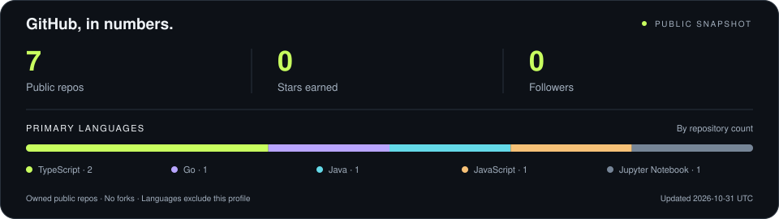

<picture>
  <source media="(max-width: 600px)" srcset="./assets/header-mobile.svg" />
  
</picture>

 

<a href="#projects"><b>Проекты</b></a> &nbsp; / &nbsp; <a href="#stack"><b>Технологии</b></a> &nbsp; / &nbsp; <a href="#activity"><b>GitHub в цифрах</b></a> &nbsp; / &nbsp; <a href="https://github.com/Rezeks?tab=repositories"><b>Все репозитории ↗</b></a>

 

### Привет, я Rezeks.

Разрабатываю веб- и мобильные приложения, пишу backend. Здесь — мои проекты на <strong>TypeScript</strong>, <strong>Java</strong>, <strong>Python</strong> и <strong>Go</strong>.

 

## 01 &nbsp; / &nbsp; Избранные проекты

От интерфейса до серверной логики. Нажми **«Что внутри»**, чтобы заглянуть в проект.

<table>
<tr>
<td width="50%" valign="top">

### 🍕 &nbsp; [next-pizza ↗](https://github.com/Rezeks/next-pizza)

Веб-приложение пиццерии: от каталога до оформления заказа.

`TypeScript` `Next.js` `React` `Prisma`

<b>Что внутри</b>

- Каталог, корзина и оформление заказов.
- Панель управления и авторизация.
- PostgreSQL, Zustand и Tailwind CSS.

[Открыть исходники →](https://github.com/Rezeks/next-pizza/tree/main/pizza)

</td>
<td width="50%" valign="top">

### 💬 &nbsp; [JAVA_session ↗](https://github.com/Rezeks/JAVA_session)

Учебный мессенджер с шифрованием, групповыми чатами и передачей файлов.

`Java 21` `Spring Boot` `PostgreSQL` `Kafka`

<b>Что внутри</b>

- Личные и групповые чаты.
- Передача файлов и работа с шифрованием.
- Spring Security и запуск через Docker.

[Открыть документацию →](https://github.com/Rezeks/JAVA_session#readme)

</td>
</tr>
<tr>
<td width="50%" valign="top">

### 📱 &nbsp; [AIU_TS ↗](https://github.com/Rezeks/AIU_TS)

Мобильное приложение для поиска скидок и магазинов.

`TypeScript` `React Native` `Expo`

<b>Что внутри</b>

- Поиск и фильтрация скидок.
- Карта магазинов и профиль пользователя.
- Мобильные интерфейсы на React Native.

[Открыть приложение в коде →](https://github.com/Rezeks/AIU_TS/tree/main/AIU_TP)

</td>
<td width="50%" valign="top">

### 🔐 &nbsp; [CryptoLab ↗](https://github.com/Rezeks/Data_encryption)

Учебная лаборатория классических шифров с веб-интерфейсом.

`Python` `FastAPI` `JavaScript`

<b>Что внутри</b>

- Шифрование и расшифровка текста.
- Эксперименты с классическими алгоритмами.
- Python API и интерфейс на HTML, CSS и JavaScript.

[Посмотреть API →](https://github.com/Rezeks/Data_encryption/blob/main/backend/main.py)

</td>
</tr>
</table>

<b>Ещё немного кода: Go и Python</b>

| Репозиторий | Что можно найти |
| :--- | :--- |
| [delivery](https://github.com/Rezeks/delivery) | Go-библиотека для расчёта объёмного веса и стоимости доставки. |
| [Python](https://github.com/Rezeks/Python) | Telegram-боты на aiogram и Jupyter notebooks. |

 

## 02 &nbsp; / &nbsp; Технологии в моих проектах

| Направление | Стек |
| :--- | :--- |
| **Web** | TypeScript · JavaScript · React · Next.js · Tailwind CSS |
| **Mobile** | React Native · Expo |
| **Backend** | Java · Spring Boot · Python · FastAPI · Go |
| **Данные и инструменты** | PostgreSQL · Prisma · Kafka · Docker · Git |

 

## 03 &nbsp; / &nbsp; GitHub в цифрах

<a href="https://github.com/Rezeks?tab=repositories">
  <picture>
    <source media="(max-width: 600px)" srcset="./assets/stats-mobile.svg" />
    
  </picture>
</a>

Как обновляется карточка

Статистика собирается из публичного GitHub API ежедневно через GitHub Actions. Дата последнего обновления указана на изображении; языки считаются по основному языку каждого публичного проекта, без форков и этого профильного репозитория.

[История обновлений](https://github.com/Rezeks/Rezeks/actions/workflows/profile-stats.yml) · [Скрипт генерации](./scripts/update_stats.py)

 

---

<strong>Есть идея или вопрос по проекту?</strong> Создай issue в соответствующем репозитории — так обсуждение останется рядом с кодом.

 

[Смотреть проекты ↗](https://github.com/Rezeks?tab=repositories) &nbsp; · &nbsp; [К началу ↑](#)

REZEKS &nbsp; / &nbsp; BUILD · LEARN · REPEAT

